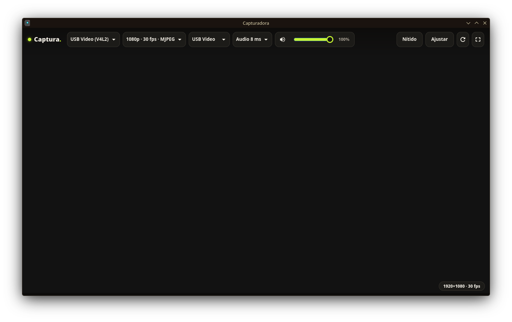

# Capturadora

Visor para tarjetas capturadoras USB en Linux: muestra el video y reproduce el audio de tu
capturadora en una ventana, con poca latencia. Pensado para ver tu consola o segundo PC en
pantalla, o para tenerlo abierto mientras transmites.



## Características

- Video por V4L2 y audio por PipeWire, con selección de dispositivo.
- Calidad configurable (por ejemplo 1080p a 30 fps en MJPEG).
- Ajuste de retraso del audio para sincronizar imagen y sonido.
- Control de volumen y silencio (tecla `M`).
- Modo «Nítido»: escalado por GPU con nitidez, útil para fuentes de 720p.
- «Ajustar» / «Estirar»: mantiene la proporción o llena toda la ventana.
- Pantalla completa (tecla `F`) y botón para reconectar el dispositivo.
- Indicador de resolución y fps reales de la señal.
- Recuerda tu configuración entre sesiones.

## Requisitos

- Linux con PipeWire (`pactl`) y una capturadora compatible con V4L2
- Flatpak (usa GTK4 + GStreamer del runtime de GNOME; se instala solo)

## Instalación

```bash
git clone https://github.com/cecilio120/capturadora.git
cd capturadora
./install.sh
```

Se instala para tu usuario en `~/.local/share/capturadora` y aparece como «Capturadora» en
el menú de aplicaciones. No toca el sistema base.

## Uso

Abre «Capturadora», elige tu dispositivo de video, la calidad y el audio en la barra
superior (aparece al mover el ratón). Si algo se queda trabado, pulsa el botón de reconectar.

## Compatibilidad con el Mezclador (opcional)

La Capturadora funciona sola, no necesita nada más. Si tienes instalado el
[Mezclador](https://github.com/cecilio120/mezclador), conecta su audio directo al canal
Extra, así no se mueve de canal al abrir y se evita un chasquido. Sin el Mezclador, el audio
sale por tu salida predeterminada y, para suavizar el arranque, se silencia unos 3 segundos.

## Desinstalar

```bash
rm -rf ~/.local/share/capturadora ~/.config/capturadora \
  ~/.local/share/applications/io.github.capturadora.Capturadora.desktop
```
